<!-- Terminal-style animated profile.
     SVGs in assets/ are generated by `node scripts/render.mjs` from data/*.json.
     The contribution graph is refreshed from real GitHub data every 6 hours by
     .github/workflows/update-profile-art.yml (bot commits don't count as contributions). -->

<h3><code>tejas@github ~ $ ./contributions.sh</code></h3>

 
 

<h3><code>tejas@github ~ $ whoami</code></h3>

<table width="860">
<tr>
<td valign="top" width="430"></td>
<td valign="top" width="430"></td>
</tr>
</table>

 

<h3><code>tejas@github ~ $ ./links.sh</code></h3>

<b>Freelance Full-Stack &amp; Agentic AI Developer · Pune, Maharashtra</b>

 
 

<h3><code>tejas@github ~ $ ./stack.sh</code></h3>

 

 

 
 

<h3><code>tejas@github ~ $ ls ~/projects --featured</code></h3>

| Project | What it is | Stack | Links |
| --- | --- | --- | --- |
| **PeoplePilot OS** *(contributor)* | Enterprise multi-tenant HRMS — hiring, attendance, payroll & statutory compliance, performance, AI HR assistant. | TypeScript · React · Node.js · PostgreSQL · Redis | [Live](https://peoplepilotos.com/) |
| **Mangalam Shadi** | Matrimonial platform with advanced matching, real-time chat, premium plans and an Android app. | React · Express · Socket.IO · Firebase · Razorpay · Capacitor | [API code](https://github.com/TejasJore33/matrimonial-backend) |
| **AVIS Engineering** | Platform for an NDT consultancy — services, quotations, billing dashboard, PDF documents. | React · TypeScript · Firebase · React-PDF | [Live](https://avisengineering.com/) |
| **Ratibz** | Daily-subscription & local-delivery marketplace with customer and partner mobile apps. | C# · ASP.NET Core · .NET MAUI | Private |
| **VetCare 360** | Multi-tenant platform for veterinary clinics with admin console and real-time features. | Express · Prisma · PostgreSQL · BullMQ · Docker | Private |
| **SastaMastaRide** | Two-wheeler ride-pooling MVP with maps and in-app payments. | React · Express · Google Maps · Razorpay | Private |

More work and details on <a href="https://tejasj.is-a.dev">tejasj.is-a.dev</a>

 
 

<h3><code>tejas@github ~ $ ./stats.sh</code></h3>

<table width="860">
<tr>
<td align="center" width="50%"></td>
<td align="center" width="50%"></td>
</tr>
</table>

